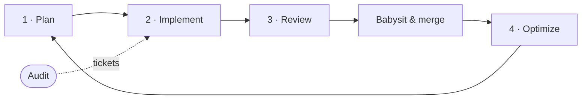
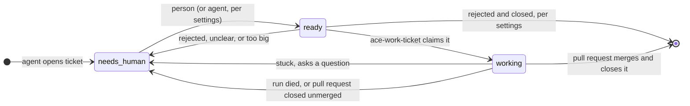

<div align="center">


# Ace

**A**gentic **C**oding **E**nvironment

An adaptable, agentic skills framework for Claude Code, Cursor, Codex, Antigravity, and OpenCode.

[Get started](#get-started) · [Skills](#skills-you-need-to-know) · [The Ace cycle](#the-ace-cycle) · [Compatibility](#compatibility) · [Project files](#project-files) · [Settings](#settings) · [Roadmap](#roadmap)

</div>

> [!WARNING]
> This project is in pre-alpha and not ready to use. Alpha expected around 26.11.2026.
>
> Use Ace only in private repositories for now. Ace reads ticket comments, pull request comments, and diffs, and does not yet guard against instructions hidden in them. In a public repository anyone can write those, and a run with nobody watching, such as `ace-work-ticket`, can push code.

The new age of programming isn't … programming. It's probably not even engineering. Writing code is not just cheap; for many workflows it is largely delegated to agents. With Ace, the role shifts: less direct code authorship, more engineering of the factory and the inputs that the factory receives.

## Why Ace

Ace builds on skills from pstack and Matt Pocock, joins them into one cycle, and adds what they leave out:

- 🧭 **One router.** You say what you want, and `ace-mode` picks the skills and their order. You need no skill names.
- 🔌 **Fits your project.** Ace reads your checks and ticket tracker from small files in `ace/`, and works on defaults before you write any.
- 🛠️ **A review that fixes.** `ace-review` checks a change against its ticket, your coding standards, and its code, fixes what your settings allow, and on a pull request rates its Merge Danger: how hard it is to undo, and how much it can break.
- 🤖 **Runs with no person.** Start Ace from any runner you set up, such as a CI job or a scheduled cloud agent, and it turns ready tickets into pull requests and audits the repo. A person merges. (Private repositories only for now; see the warning above.)

## Get started

1. **Install** Ace into your project, the same way in every harness. Ace installs as one set, because its skills load each other.

   ```sh
   npx skills add tobimey/ace
   ```

2. **Commit** what it installed: `.agents/skills/`, `.claude/skills/`, and `skills-lock.json`. Every teammate and CI run then uses the same Ace version, with no install step. To update, run the install again and commit. Your `ace/` files hold only your project's facts, so they need no change.
3. **Turn on Ace**: run `/ace-setup`. It guides you through 4 quick steps (project overview & glossary in `AGENTS.md` / `CLAUDE.md`, checks & verification in `ace/VERIFY.md`, testing your checks, and turning Ace on), previewing each step before writing anything, then offers to continue right away with optional modules. You edit nothing by hand. The Ace section also tells the agent to answer questions without changing files, and to change files only when you ask.

   <details>
   <summary>Skip the setup run and paste one line instead</summary>

   Turning on `ace-mode` is the one step Ace needs. Every other skill stays hidden until `ace-mode` loads it, and Ace finds your checks in CI and your scripts. Paste this line into your `AGENTS.md` (or `CLAUDE.md`):

   ```markdown
   - For every task, follow the `ace-mode` skill. It picks the Ace skills for the task and their order. When you reply without having loaded `ace-mode`, start the reply with `Ace not loaded:` and the reason.
   ```

   </details>
4. **Start working, or finish setup for the full cycle.** Right away you can work in chat ("fix the login redirect", "review my changes"). To unlock the rest of Ace, run `/ace-setup tickets` (needed for tickets, audits, and `ace-work-ticket`), `/ace-setup standards` (to tailor reviews and audits to your codebase), `/ace-setup cycle` (needed for CI, scheduled, or cloud runs), or `/ace-setup settings` (to change defaults), or `/ace-setup full` to set up all of them in one pass.

> [!TIP]
> This README writes skill commands as `/ace-setup`. In Codex, type `$ace-setup`; in OpenCode (V2), type `@ace-setup` (or plain words like `Run ace-setup`).

## Skills you need to know

Ace has 17 skills. You run one yourself by name, and a runner names a few more.

| | Skills | When |
|---|---|---|
| **Run once** | `/ace-setup` | Guided step-by-step setup plus optional modules, `/ace-setup full` for everything, or one module such as `/ace-setup tickets`. |
| **Name in a runner or on request** | `/ace-help`, `/ace-work-ticket`, `/ace-audit`, `/ace-babysit-pr`, `/ace-garden` | When you want help with Ace, when a schedule or CI job should run Ace with no person, or when you want a cleanup. A runner reviews a pull request with `Review pull request #12 and comment on it.` A person can say all of these in words too. |
| **Never name** | everything else | Say what you want, such as "plan this", "fix the bug", or "review my changes", and `ace-mode` picks the skills. You can also steer the pace in plain words: "just build it" or "go with your recommendations" to skip pauses, "quick fix ..." for an obvious bug, or "... and open a PR" / "... and review it" to chain steps in one turn (verification, coding standards, and the no-merge rule always stay on). |

## The Ace cycle

Software is rarely done, so Ace works in a loop: plan, implement, review, merge, and improve the system that does it. Audits feed new tickets into the loop.



| Stage | Skill | What it does |
|---|---|---|
| Plan | `ace-grill` | Settles what to build: ranks directions against your goal, or judges a proposed change, assumes sensible defaults for low-stakes details, interviews you only on material decisions, and writes the plan into a ticket when needed. |
| Plan | `ace-to-ticket` | Turns a plan into one ticket or several sub-tickets. |
| Implement | `ace-diagnose` | Finds and proves the root cause of an unclear or intermittent bug (obvious bugs go straight to a failing regression test and fix). |
| Implement | `ace-implement` | Builds the plan test-first. |
| Implement | `ace-verify` | Proves it works. |
| Implement | `ace-open-pr` | Opens the pull request. |
| Implement | `ace-work-ticket` | Runs this stage with no person: takes the next ready ticket, builds it, and opens a pull request. It skips a ticket an open pull request covers, and rejects one that is already done or wrong, with the evidence. |
| Review | `ace-review` | Checks the change against its ticket (**spec**), your coding standards (**standards**), its code (**code**), and your custom checks in `ace/checks/`. It fixes what `autonomy` allows and reports the rest. On a pull request it pushes its fixes and rates the Merge Danger; on a local diff it leaves them for you to commit. |
| Merge | `ace-babysit-pr` | Gets open pull requests ready: fixes failing checks, retries a flaky one once, resolves conflicts, and answers review comments from people and bots: it fixes what `autonomy` allows, proves a false claim wrong, and names scope creep as a follow-up. It never merges. Run it once, or in watch mode until each pull request is ready or needs a person. |
| Optimize | `ace-optimize-factory` | Runs a retro on a session, fixes one named misbehaviour, or checks the agents file. |
| Optimize | `ace-skill-best-practices` | Creates and edits skills. |

Outside the loop:

| Skill | What it does |
|---|---|
| `ace-mode` | The router. Picks the skills for each message, skips extra steps on straightforward tasks, and supports fast-tracking ("go with your recommendations" or "just do it"). It is the only skill the agent sees on its own; the others are hidden until it loads them, and you can still invoke any of them by name. |
| `ace-help` | Explains how Ace works, what it can do, and what is configured in your project. Ask in words or run `/ace-help`. |
| `ace-setup` | Guides you step by step through setting up Ace: 4 core steps first (with previews before writing), then offers the remaining modules (`tickets`, `standards`, `cycle`, `settings`) or `full`, one decision at a time. |
| `ace-audit` | Audits the whole codebase per domain: security, logic, performance, architecture, health, and your custom checks. Each domain files up to three tickets by default. `/ace-audit security` runs one domain; `/ace-audit` asks which. Usually runs on a schedule. |
| `ace-garden` | Makes one small cleanup per run, below an audit's bar, on a topic and scope you pick, such as `/ace-garden naming src/billing`. Topics: **naming**, **comments** (tautological, stale, or excuse comments and unjustified suppressions), **tests** that cannot fail, **pass-through** wrappers, **deps** (bumps, keeping risky majors for a person), and your custom checks. It fixes one finding with behavior unchanged, or names up to three candidates when no fix is clean. Ask for a report to see findings without a change. |
| `ace-explain` | Explains how code works and why. For a pull request it can post an explainer with a code walkthrough and a quiz; add it to the CI step that runs your reviews to get one on every pull request. |

## Compatibility

- **Models.** Use a model that scores above 40 on the [Artificial Analysis Intelligence Index](https://artificialanalysis.ai/models#intelligence). Ace skills are long and call each other, and weaker models skip steps. Above that bar, Ace works with any model and any kind of project.
- **Harnesses.** Claude Code, Cursor, Codex, Antigravity, and OpenCode (V2; V1 ignores `disable-model-invocation` and exposes every skill to the model) are supported. The skills are plain Markdown in the Agent Skills format, so others may work, untested. Ace ships skills only, no harness plugins yet.
- **GitHub only.** Pull requests work on GitHub only, through a logged-in `gh` CLI; Ace handles no tokens. Without GitHub, review, verify, and explain still work on your local diff. Tickets can live in GitHub Issues or another tracker, such as Linear or Jira.
- **No CI config.** For runs with no person, you set up the runner, local or in the cloud. Ace writes none.

> [!TIP]
> Review with a different model than the one that implemented the change. A model tends to miss the mistakes it made. Set `review.require_other_model` to make it a rule.

---

> [!NOTE]
> The sections from here on are reference. You need them once you change how Ace works in your project.

## Project files

The files in `ace/` tell Ace how your project works. Core setup writes `VERIFY.md`, which is enough for interactive chat and default reviews. The other files unlock the rest of Ace: without them, Ace falls back to the default in the last column (and stops in unattended runs when a tracker or runner config is missing), naming any default it used in one line of its reply.

The files are yours: `ace-setup` writes a first draft, and you change them as the project needs. Ace reads only a few sections, finds each by its job under any heading, and leaves the rest free.

| File | What it says | Who writes it | Without it |
|---|---|---|---|
| `VERIFY.md` | How to prove a change works: the checks that must pass, how to start the app, and how to try each kind of change, with the fastest tool made for agents, such as Vercel's `agent-browser`, before slower ones like a browser MCP. `ace-verify` follows it, and `ace-review` runs its checks. | `/ace-setup` (core setup) | Runs the checks your CI runs, plus lint, test, or build scripts CI skips. Starts the app with your dev script. |
| `CODING_STANDARDS.md` | Your coding rules, which review and audit check against, plus optional sections: paths to skip, parties you trust, risks the team accepts, and packages whose major only a person bumps. | `/ace-setup standards` | The rules in [the template](skills/ace-setup/templates/CODING_STANDARDS.md). No party is trusted, no risk is accepted. |
| `checks/` | Your own checks, one file each, such as `checks/ACCESSIBILITY.md`. Each says what to find, what to drop, and how severe a finding is. `ace-review` runs each as a check, `ace-audit` as a domain, and `ace-garden` as a topic. Single rules go in `CODING_STANDARDS.md`. | You, from [the template](skills/ace-setup/templates/CHECK.md) | Only the built-in checks run. |
| `TICKET_TRACKER.md` | How to read, search, open, and update tickets in a tracker such as Linear or Jira, and how it shows the [ticket states](#ticket-states). GitHub Issues needs no file: set `"ticket_tracker": "github-issues"`, and write a file only to override a part, such as an assignee on every ticket, or a GitHub project with Priority and Size fields. | `/ace-setup tickets` | No tracker: Ace writes each ticket into the reply. |
| `PRODUCT.md` | Who the product is for, the goal "better" means right now, what it leaves alone, and the direction picked for each part. `ace-grill` ranks directions against it. | `ace-grill`, the first time you pick a direction | `ace-grill` asks for the users, goal, and non-goals. |
| `CYCLE.md` | What starts runs besides a person, such as a CI job or a scheduled cloud agent, the message each run gets, and, for a runner that differs from a local run, how it finds its pull request or ticket, what it must not touch, and how it posts when `gh` there acts as a person. Ace writes no runner config: you set up the runner. | `/ace-setup cycle` | A person starts every run, and `ace-mode` names the next step. |
| `GLOSSARY.md` | Every project term with its detail, once the core glossary in `AGENTS.md` outgrows it. See [Glossary](#glossary). | `ace-grill` proposes it | The core glossary in `AGENTS.md`. |
| `adrs/` | Hard-to-reverse decisions, one ADR each. `ace-implement` and `ace-explain` read them whenever the folder exists. | `ace-grill`, when `write_adrs` is on | No ADRs. |
| `config.json` | How much agents do on their own and how they talk to you. See [Settings](#settings). | `/ace-setup settings` | The defaults in the schema. |

Your own pull request rules go in your pull request template or your `AGENTS.md`.

### Ticket states



`ace-work-ticket` claims a ready ticket and sets it `working`, one run at a time. The ticket stays `working` until its pull request merges and closes it. When a run dies, or a person closes its pull request unmerged, the next run finds the ticket still `working` with no open pull request and, once the claim is 90 minutes old, sends it back to `needs-human` with a comment saying why. On GitHub Issues, the states are the labels `ace:needs-human`, `ace:ready`, and `ace:working`, and a ticket with high Risk also gets `risk:high`. A ticket with no state label is outside the agent queue, such as one a person builds.

### Model attribution

Everything Ace posts, such as a pull request, a review comment, or a ticket, starts with a line naming the model that wrote it, such as `Model: claude-sonnet-4-6` (or `Model: unknown` when the harness exposes no id). A runner can set it with `ACE_MODEL`. Every ticket and pull request Ace opens also gets the permanent label `ace-created`, also when you asked for it in chat, so you can filter for Ace's work. It says who opened a ticket; the `ace:` state labels say whose turn it is.

### Monorepos

A package can have its own `ace/` folder with a `VERIFY.md`, and a `CODING_STANDARDS.md` for its own rules, such as `apps/web/ace/VERIFY.md`. `ace-setup` creates one for each package with its own checks or app. Nothing lists them: for a changed file, Ace reads the root `ace/` folder plus every `ace/` folder between that file and the root. A change runs the root and package checks, and the root coding standards win on conflict. The glossary, ticket tracker, and settings exist only at the root.

### Glossary

The glossary is the shared language between you and the agent. Its core is a Glossary section in your root `AGENTS.md`, one line per term, up to about 25, because harnesses load that file into every session. `ace-grill` adds terms as plans settle them. Once the core outgrows that, or one word means different things in different parts of the project, it proposes a full `ace/GLOSSARY.md` and keeps the terms you pick in the core.

## Settings

Settings say how much agents do on their own and how they talk to you. They live in `ace/config.json`. A missing file or setting uses its default, so a new Ace version needs no change to the file. The `$schema` line lets your editor check the values and explain each setting.

```json
{
  "$schema": "../.agents/skills/ace-setup/config.schema.json",
  "autonomy": "medium",
  "communication": "code",
  "ticket_tracker": "github-issues",
  "review": { "require_other_model": false },
  "write_adrs": false
}
```

| Setting | Values and meaning |
|---|---|
| `autonomy` | `low`: a person sets every ticket ready, reviews fix nothing, and a ticket `ace-work-ticket` rejects waits for a person. `medium` (default): reviews also fix what has one clearly correct fix. `high`: tickets from a plan you approved go ready on their own, reviews pick a fix when several are reasonable, and `ace-work-ticket` closes a ticket it rejects. Tickets from `ace-audit` still wait for a person. Spec and architecture findings, and fixes that change a product decision, a public contract, or stored data, always stay findings. |
| `communication` | `code` (default): refer to files, lines, symbols, and code as needed. `product`: speak in user-facing behavior, flows, and glossary terms in chat replies and pull request explainers, omitting file paths, line numbers, symbol names, code snippets, and raw stack traces unless you ask. Posted pull request review comments, commits, audit tickets, and `ace/` files keep code references for agents. |
| `ticket_tracker` | `github-issues` uses the built-in GitHub Issues tracker. Leave it out for another tracker, described in `ace/TICKET_TRACKER.md`, or for none. |
| `review.require_other_model` | `true`: a session never reviews a change it built, and gives you the line to start the review on another model, such as a new session or your runner. `false` (default): it reviews on request and adds a tip to use another model. |
| `write_adrs` | `true`: `ace-grill` records each hard-to-reverse decision as an ADR in `ace/adrs/`. Default `false`. |

Everything else you say in the message, such as "review this with one agent per check", "audit security, up to 5 tickets", or, for a runner, `Run ace-work-ticket. Open the pull request as a draft.`

## Roadmap

- **Review with other models**, from other providers when the harness can reach them.
- **Runner recipes**, such as GitHub Actions workflows that review, work tickets, and audit on a schedule.
- **Evals** that run skills on fixed tasks, so a skill change shows what it fixed and broke.
- **Many repos** sharing one company config through `"extends"` in `ace/config.json`.

## Credits

Ace builds on ideas and skills from these projects:

- [mattpocock/skills](https://github.com/mattpocock/skills) by Matt Pocock (MIT). The retro in `ace-optimize-factory` is adapted from his `retro` skill, `ace-diagnose` from his `diagnosing-bugs` skill, the deep-module vocabulary in `ace-mode` from his `codebase-design` skill, the architecture domain of `ace-audit` follows his `improve-codebase-architecture` survey, and `ace-grill` and `ace-to-ticket` follow his grilling and ticket-slicing workflows.
- [pstack](https://cursor.com/marketplace/cursor/pstack) by Lauren Tan (MIT, [mirror](https://github.com/backnotprop/pstack)). `ace-mode` and the playbook-style skills take after its approach. `ace-explain` is adapted from its `how`, `why`, and `teach` skills.
- [explain-diff](https://gist.github.com/geoffreylitt/a29df1b5f9865506e8952488eac3d524) by Geoffrey Litt. The explainer in `ace-explain` follows its idea of explaining a change with background, intuition, a code walkthrough, and a quiz.

The license notices of these projects are in [THIRD_PARTY_NOTICES.md](THIRD_PARTY_NOTICES.md).

## License

Ace is under the MIT License. See [LICENSE](LICENSE).
