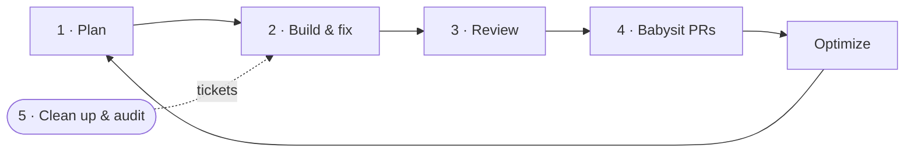

<div align="center">


# Ace

**A**gentic **C**oding **E**nvironment

An adaptable, agentic skills framework for Claude Code, Cursor, Codex, Antigravity, and OpenCode.

[How it works](#how-it-works) · [Get started](#get-started) · [Scale when ready](#scale-when-ready) · [Compatibility](#compatibility) · [Roadmap](#roadmap)

</div>

> [!WARNING]
> This project is in pre-alpha and not ready to use. Alpha expected around 26.11.2026.
>
> Use Ace only in private repositories for now. While `ace-babysit-pr` and `ace-work-ticket` ignore comments from outside contributors and `ace-babysit-pr` / `ace-review` never edit control files (such as `.github/workflows/` or `AGENTS.md`), Ace still reads code diffs and does not yet run untrusted diffs in a read-only sandbox.

Writing code is no longer the bottleneck. With Ace, your job shifts from typing every change to steering an agent workflow that plans, implements, verifies, and reviews changes in a repeatable loop.

## Why Ace

Ace builds on skills from pstack and Matt Pocock, joins them into one cycle, and adds what they leave out:

- 🧭 **One router, plain language.** Say what you want, and `ace-mode` picks the right skills in the right order. You need no skill names.
- 🔌 **Works out of the box.** Ace starts on sensible defaults and reads your project's checks and rules from small files in `ace/` only when you add them.
- 🛠️ **A review that fixes.** Ace checks a change against its spec, your coding standards, and its code, fixes what your settings allow, and rates Merge Danger on pull requests.
- 🤖 **Scales to automation.** Start in interactive chat today; later, connect tickets and CI or scheduled runners to turn ready tickets into pull requests and audit your repo automatically. A person always merges.

## How it works

Ace runs software work around five plain workflows: **Plan**, **Build & fix**, **Review**, **Babysit PRs**, and **Clean up & audit**.



Just say what you want in chat. You do not need to memorize skill names:

| Workflow | You say | Ace does |
|---|---|---|
| **Plan** | `"Plan dark mode for the settings page"` | Challenges the idea, settles key decisions with you, and writes a plan or ticket. |
| **Build & fix** | `"Fix the login redirect loop"` or `"Implement this plan"` | Finds the root cause or reads the plan, builds test-first, and runs your checks. |
| **Review** | `"Review my changes"` | Checks the diff against your standards and code quality, reports findings (asks before fixing locally; pushes obvious fixes in CI). |
| **Babysit PRs** | `"Babysit PR #12"` | Built for CI or cloud runners (uses a temporary worktree locally). Fixes failing CI, resolves conflicts, and answers review comments until ready for a person to merge. |
| **Clean up & audit** | `"Clean up naming in src/billing"` or `"/ace-audit security"` | Makes one focused cleanup with behavior unchanged, or audits a domain across the repo and files tickets. |

You can also ask Ace to **Explain** how code or a PR works, **Improve the setup (Optimize)** when agents go wrong or you want to edit a skill, or run **`/ace-help`** (or **`/ace-help tour`**) to see what is configured and get a repo-tailored walkthrough.

Steer the pace in plain words: say `"just build it"` or `"go with your recommendations"` to skip pauses, `"quick fix ..."` for an obvious bug, or `"... and open a PR"` / `"... and review it"` to chain steps in one turn. Verification, coding standards, and the no-merge rule always stay on.

See [docs/SKILLS.md](docs/SKILLS.md) for the workflows, pace shortcuts, and the full skill reference under the hood.

## Get started

Start in chat in three steps. No ticket tracker, CI config, or settings file required.

1. **Install** Ace into your project:

   ```sh
   npx skills add tobimey/ace
   ```

2. **Commit** what it installed: `.agents/skills/`, `.claude/skills/`, and `skills-lock.json`. Every teammate and CI run then shares the same Ace version with no extra install step. To update later, run the install command again and commit.

3. **Run `/ace-setup`** in your coding agent. It walks you through 4 quick steps (project overview and glossary in `AGENTS.md` / `CLAUDE.md`, verification checks in `ace/VERIFY.md`, testing those checks, and turning Ace on), previewing every file before writing it. It keeps the coding standards docs you already have, offers to delete your own skills that duplicate an Ace skill, and ends with 3 tailored prompts for your repo.

   <details>
   <summary>Skip setup and paste one line instead</summary>

   Turning on `ace-mode` is the only step Ace strictly needs. Paste this line into your `AGENTS.md` (or `CLAUDE.md`):

   ```markdown
   - For every task, follow the `ace-mode` skill. It picks the Ace skills for the task and their order. When you reply without having loaded `ace-mode`, start the reply with `Ace not loaded:` and the reason.
   ```

   </details>

> [!TIP]
> This README writes skill commands as `/ace-setup`. In Codex, type `$ace-setup`; in OpenCode (V2), type `@ace-setup` (or plain words like `Run ace-setup`).

## Scale when ready

Core setup writes `ace/VERIFY.md` and gives you interactive planning, building, fixing, verification, and local or PR reviews right away. When you want more, add optional modules in two groups:

- **Customize chat & reviews** (`/ace-setup standards`, `/ace-setup settings`): edit your project rules (`CODING_STANDARDS.md`, optional `checks/`) and preferences (`config.json`). See [Configuration & project files](docs/CONFIGURATION.md) for the files you edit, monorepo support, and the agent-managed state Ace maintains for you (`PRODUCT.md`, `GLOSSARY.md`, `adrs/`, `temporary-plans/`).
- **Tickets & automation** (`/ace-setup tickets`, `/ace-setup cycle`): connect GitHub Issues or another tracker (`TICKET_TRACKER.md`) and record automated CI or scheduled runs (`CYCLE.md`). See [Tickets & automation](docs/AUTOMATION.md).
- **[Workflows & skills](docs/SKILLS.md):** The five workflows, direct commands, pace shortcuts, and the full skill reference under the hood.

Or run `/ace-setup full` to configure everything in one guided pass.

## Compatibility

- **Models.** Use a model that scores above 40 on the [Artificial Analysis Intelligence Index](https://artificialanalysis.ai/models#intelligence). Ace skills are long and call each other, and weaker models skip steps.
- **Harnesses.** Claude Code, Cursor, Codex, Antigravity, and OpenCode (V2; V1 ignores `disable-model-invocation` and exposes every skill to the model). The skills are plain Markdown in the Agent Skills format, so others may work, untested.
- **GitHub only.** Pull requests work on GitHub only, through a logged-in `gh` CLI; Ace handles no tokens. Without GitHub, review, verify, and explain still work on your local diff. Tickets can live in GitHub Issues or another tracker, such as Linear or Jira.
- **No CI config.** For automated runs, you set up the runner (local or cloud). Ace writes no CI config.

> [!TIP]
> Review with a different model than the one that implemented the change. A model tends to miss the mistakes it made. Set `review.require_other_model` in `ace/config.json` to make it a rule.

## Roadmap

- **Review with other models**, from other providers when the harness can reach them.
- **Runner recipes**, such as GitHub Actions workflows that review, work tickets, and audit on a schedule.
- **Evals** that run skills on fixed tasks, so a skill change shows what it fixed and broke.
- **Many repos** sharing one company config through `"extends"` in `ace/config.json`.

## Credits

Ace builds on ideas and skills from these projects:

- [mattpocock/skills](https://github.com/mattpocock/skills) by Matt Pocock (MIT). The retro in `ace-optimize-factory` is adapted from his `retro` skill, `ace-diagnose` from his `diagnosing-bugs` skill, the deep-module vocabulary in `ace-mode` from his `codebase-design` skill, the architecture domain of `ace-audit` follows his `improve-codebase-architecture` survey, and `ace-grill` and `ace-to-ticket` follow his grilling and ticket-slicing workflows.
- [pstack](https://cursor.com/marketplace/cursor/pstack) by Lauren Tan (MIT, [mirror](https://github.com/backnotprop/pstack)). `ace-mode` and the playbook-style skills take after its approach. `ace-explain` is adapted from its `how`, `why`, and `teach` skills.
- [explain-diff](https://gist.github.com/geoffreylitt/a29df1b5f9865506e8952488eac3d524) by Geoffrey Litt. The explainer in `ace-explain` follows its idea of explaining a change with background, intuition, a code walkthrough, and a quiz.

The license notices of these projects are in [THIRD_PARTY_NOTICES.md](THIRD_PARTY_NOTICES.md).

## License

Ace is under the MIT License. See [LICENSE](LICENSE).
