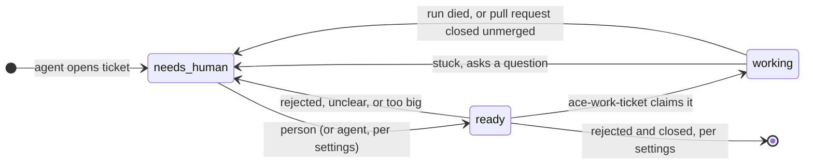

<div align="center">


# Ace

**A**gentic **C**oding **E**nvironment

An adaptable, agentic skills framework for Claude Code, Cursor, and Codex.

[Get started](#get-started) · [The Ace cycle](#the-ace-cycle) · [Project files](#project-files) · [Settings](#settings) · [Roadmap](#roadmap)

</div>

> [!WARNING]
> This project is in active development and not ready to use. Pre-Alpha expected by 18.11.2026.
>
> Use Ace only in private repositories for now. Ace reads ticket comments, pull request comments, and diffs, and does not yet guard against instructions hidden in them. In a public repository anyone can write those, and a run with nobody watching, such as `ace-work-ticket`, can push code.

The new age of programming isn't … programming. It's probably not even engineering. Writing code is not just cheap; for many workflows it is largely delegated to agents. With Ace, the role shifts: less direct code authorship, more engineering of the factory and the inputs that the factory receives.

## Why Ace

Ace builds on skills from pstack and Matt Pocock, joins them into one cycle, and adds what they leave out:

- 🧭 **One router.** You say what you want, and `ace-mode` picks the skills and their order. You need no skill names.
- 🔌 **Fits your project.** Ace reads your checks and ticket tracker from small files in `ace/`, and works on defaults before you write any.
- 🛠️ **A review that fixes.** `ace-review` checks a change against its ticket, your coding standards, and its code, fixes what your settings allow, and on a pull request rates its Merge Danger: how hard it is to undo, and how much it can break.
- 🤖 **Runs with no person.** Start Ace from any runner you set up, such as a CI job or a scheduled cloud agent, and it turns ready tickets into pull requests and audits the repo. A person merges.

## Get started

1. **Install** Ace into your project. This works the same in every harness. Ace installs as one set: its skills load each other, so install all of them.

   ```sh
   npx skills add tobimey/ace
   ```

2. **Commit** what it installed: `.agents/skills/`, `.claude/skills/`, and `skills-lock.json`. Then every teammate and every CI run uses the same Ace version, and CI needs no install step.
3. **Turn on Ace**: run `/ace-setup`. In a few minutes it turns on `ace-mode` in your `AGENTS.md` and writes `ace/VERIFY.md` with your checks. Every other Ace skill stays hidden until `ace-mode` loads it, so turning it on is the one step you need. To do only that, paste this line into your `AGENTS.md` (or `CLAUDE.md`):

   ```markdown
   - For every task, follow the `ace-mode` skill. It picks the Ace skills for the task and their order. When you reply without having loaded `ace-mode`, start the reply with `Ace not loaded:` and the reason.
   ```

   Nothing else needs setup: Ace finds your checks in CI and your scripts, and works without a ticket tracker.
4. **Start working.** Say what you want, such as "fix the login redirect" or "review my changes", and `ace-mode` picks the skills. Teach Ace more when you need it, one part at a time: `/ace-setup tickets`, `/ace-setup cycle`, `/ace-setup standards`, or `/ace-setup settings`.
5. **Update** by running `npx skills add tobimey/ace` again and committing. Your `ace/` files hold only your project's facts, and the GitHub files update with Ace, so they need no change.

> [!TIP]
> This README writes skill commands as `/ace-setup`. In Codex, type `$ace-setup` instead.

## The Ace cycle

You can call it a factory. You can call it a restaurant. You can call it a garden. Many terms match. Ace uses the term **cycle**: software is rarely ever "done."

The cycle is a loop. It starts with an idea that forms into a plan. The plan gets implemented. The code gets verified, tested and reviewed. This is the inner loop. It's the core software cycle that drives the software development process.


Every skill has its own folder in `skills/`, such as `skills/ace-review/`.

### Stage 1 · Plan

| Skill | What it does |
|---|---|
| `ace-grill` | Settles what to build. It starts where your message leaves off. With no direction yet ("how can I make this better"), it offers a few directions ranked against your goal and stops once you pick one, so the question ends in a decision instead of a growing list of ideas. For a change you propose, it first says whether it makes sense: do it, do it differently, or leave it. Then it interviews you until the plan is settled and writes it into a ticket. |
| `ace-to-ticket` | Turns a plan or spec into one ticket or several sub-tickets, and opens every ticket in the shared Ace shape. |

### Stage 2 · Implement

| Skill | What it does |
|---|---|
| `ace-diagnose` | Finds and proves the root cause of a bug. |
| `ace-implement` | Builds the plan test-first. |
| `ace-verify` | Proves it works. |
| `ace-open-pr` | Opens the pull request. |
| `ace-work-ticket` | Runs this stage with no person: it takes the next ready ticket, builds it, and opens a pull request, usually on a schedule. First it checks the ticket: it skips one an open pull request already covers, and rejects one whose work is already done or whose claim is wrong, with the evidence. |

### Stage 3 · Review

| Skill | What it does |
|---|---|
| `ace-review` | Runs three checks on the change: **spec** (does it do what the ticket asked), **standards** (your coding standards), and **code** (logic, security, performance, and architecture), plus each custom check you add in `ace/checks/`. It fixes what the `review` settings allow, writes the rest as findings, and on a pull request rates the Merge Danger. On a pull request it checks out its branch, then commits and pushes its fixes there. On a local diff it leaves them uncommitted, and you commit. |

### Between review and merge

| Skill | What it does |
|---|---|
| `ace-babysit-pr` | Does the work open pull requests still need. It fixes failing checks, retries a flaky check once, merges the base branch in to resolve conflicts, and answers review comments from people and bots: it fixes what `autonomy` allows, proves a false claim wrong, and names scope creep as a follow-up. It never merges. Run it once, or in watch mode until each pull request is ready or needs a person. |

### Stage 4 · Optimize

Skills that improve the agentic system so it works better next time.

| Skill | What it does |
|---|---|
| `ace-optimize-factory` | Runs a retro on a session, fixes one named misbehaviour, or checks the agents file. |
| `ace-skill-best-practices` | Creates and edits skills. |

### Beyond the cycle

On top of the cycle, Ace provides a few more skills:

| Category | Skill | What it does |
|---|---|---|
| Router | `ace-mode` | Picks the playbook for each message and runs its skills in order. It is the only skill the agent sees on its own. Every other skill is hidden from the agent: `ace-mode` and other skills load it by path, and you run it as a slash command. It also holds the files other skills share: how to read `ace/`, the logic, security, performance, and architecture rules that `ace-review` and `ace-audit` use, and the deep-module vocabulary for design work. |
| Setup | `ace-setup` | Writes the files in `ace/`, with a quick setup first and one part at a time after that. |
| Audit | `ace-audit` | Audits the whole codebase for the domains you pick: security, logic, performance, architecture, health, and each custom check you add in `ace/checks/`. `/ace-audit security` runs one domain, `/ace-audit` asks which and recommends all of them. Each domain runs as its own pass and files at most three tickets by default, which feed into stage 2. It usually runs on a schedule. |
| Garden | `ace-garden` | Makes one small cleanup per run, the kind an audit leaves below its bar, and you call it only when you want it. Pick a topic and a scope, such as `/ace-garden naming src/billing`: **naming** (names that hide what a thing does), **tests** (tests that cannot fail), **pass-through** (wrappers and props that only forward), **deps** (bumps outdated dependencies, keeping risky majors for a person), or any custom check in `ace/checks/`. It fixes one finding with behavior unchanged, or names up to three candidates when no fix is clean. Ask for a report to see every finding without a change. |
| Understand | `ace-explain` | Explains how code works, why it is built that way, or both for a change. Asked for an explainer, it writes one for a pull request, with a code walkthrough and a quiz, and posts it there. Ask for it by name, or add it to the CI step that runs your reviews. |
| Understand | `ace-learn` | Teaches a topic over several sessions. |

## Compatibility

### Models

Use a model that scores above 40 on the [Artificial Analysis Intelligence Index](https://artificialanalysis.ai/models#intelligence). Ace skills are long, multi-step instructions that call each other, and weaker models skip steps or drop rules. Above that bar, Ace works with any model and any kind of project.

> [!TIP]
> Review with a different model than the one that implemented the change. A model tends to miss the same mistakes in review that it made while writing the code. Set `review.require_other_model` to make it a rule.

### Harnesses

| Harness | Status |
|---|---|
| Claude Code | ✅ Supported |
| Cursor | ✅ Supported |
| Codex | ✅ Supported |
| Others | ⚠️ May work, not tested |

The skills are plain Markdown and follow the Agent Skills format, so other harnesses may work too, but they are not tested yet and support is not guaranteed.

Ace ships no harness plugins yet. Plugins for Claude Code, Cursor, and Codex will come later, once Ace ships more than skills, such as hooks or agents. Until then, `npx skills add` installs the skills into the project, and the project commits them.

### GitHub only

Ace works with pull requests on GitHub only. It reads and posts through the `gh` CLI, so `gh` must be logged in wherever the agent runs, and Ace handles no tokens. Other code hosts, such as GitLab or Bitbucket, are not supported. Without GitHub, review, verify, and explain still work on your local diff, but nothing opens or reads a pull request.

Tickets are not tied to GitHub: GitHub Issues is built in, and a file in `ace/` points Ace at another tracker, such as Linear or Jira. Ace also writes no CI config: when you want runs without a person, you set up the runner.

### Local vs cloud

Some things will run in the cloud, some on a local machine. The trend likely moves toward more cloud execution. The system here is not built for one specific type of machine. When set up correctly, something running in the cloud can access an app the same way as local tooling.

---

> [!NOTE]
> The sections from here on are reference. You need them once you change how Ace works in your project.

## Project files

Ace is generic. It's suitable for all sorts of software projects in whatever language. What matters is adapting it to project and team needs.

The files in `ace/` tell Ace how your project works. Each one is optional: without it, Ace uses a default, and `ace-setup` writes it when you want your own.

| File | What it says |
|---|---|
| `CODING_STANDARDS.md` | Used in stages 2 and 3 to check that the code is written in a way that is consistent with your coding standards. Optional sections name the risks the team accepts, which review and audit leave out, and the packages whose major only a person bumps, for `ace-garden deps`. |
| `VERIFY.md` | How to prove a change works: the checks CI runs, how to start the app, and how to try each kind of change, with the fastest tool made for agents, such as Vercel's `agent-browser` for a web page, before slower ones like a browser MCP or a one-off Playwright script. `ace-verify` follows it in stage 2, and `ace-review` runs its checks in stage 3. |
| `checks/` | Your own checks, one file each, such as `checks/ACCESSIBILITY.md` with what to find, what to drop, and how severe a finding is. `ace-review` runs each one as its own check, `ace-audit` as its own domain, and `ace-garden` as a topic when you ask. Copy [skills/ace-setup/templates/CHECK.md](skills/ace-setup/templates/CHECK.md) to start one. Single rules stay in `CODING_STANDARDS.md`. |
| `TICKET_TRACKER.md` | How to read, search, open, and update tickets, e.g. in Linear or Jira, and how the tracker shows the three ticket states (see below). For GitHub Issues you need no file: set `"ticket_tracker": "github-issues"`. |
| `PRODUCT.md` | Who the product is for, the goal "better" means right now, what it leaves alone, and the direction picked for each part. `ace-grill` ranks directions against it, and writes it the first time you pick one. |
| `CYCLE.md` | What starts runs besides a person, such as a CI job or a cloud agent on a schedule, and the message each run gets. For a runner that differs from a local run, it also says how a run finds its pull request or ticket, what it must not touch, and how it posts when `gh` there acts as a person. By default a person starts every run and `ace-mode` names the next step. Ace writes no runner config: you set up the runner, and `/ace-setup cycle` writes this file to describe it. |

### Ticket states

Every ticket an agent opens starts in `needs-human`. A person reads it and sets it `ready`, unless `autonomy` lets the agent do it. `ace-work-ticket` claims a ready ticket and sets it `working`, one run at a time, or sends it back to `needs-human` with a question when it gets stuck. A ticket it rejects as already done or wrong goes to `needs-human`, or is closed at `high` `autonomy`. When a run dies, or a person closes its pull request without merging, the next run finds the ticket still `working` with no open pull request and sends it back to `needs-human` with a comment that says why. On GitHub Issues, the states are the labels `ace:needs-human`, `ace:ready`, and `ace:working`. A ticket with no state label is outside the agent queue, such as one a person builds.



### Model attribution

Everything Ace posts to a ticket tracker or a code host, such as a pull request, a review comment, or a ticket, starts with a line that names the model that wrote it, such as `Model: claude-opus-5-5`. A runner can set it with `ACE_MODEL`.

Every ticket and pull request Ace opens also gets the label `ace-created`, also when you asked for it in chat. The label stays for good, so you can filter for Ace's work. It says who opened a ticket, while the `ace:` state labels say whose turn it is.

### Your files, your rules

The files are yours. `ace-setup` writes a first draft, and from then on you change them as the project needs. Ace reads only a few sections, finds each by its job under any heading, and leaves the rest of each file free. When a file or a section is missing, Ace uses its default and names it in one line: with no `VERIFY.md` it runs the checks your CI runs, and with no ticket tracker it writes the ticket into the reply.

GitHub Issues and GitHub pull requests are built in and update with Ace. To do one part differently, such as an assignee on every ticket, write only that section in `ace/TICKET_TRACKER.md`. Your own pull request rules go in your pull request template or your `AGENTS.md`.

### Monorepos

In a monorepo, a package can have its own `ace/` folder with a `VERIFY.md`, plus a `CODING_STANDARDS.md` if the package has its own rules. `ace-setup` offers one for each package with its own checks or app, and you can add one yourself, such as `apps/web/ace/VERIFY.md`.

Nothing needs to list it: for a changed file, Ace reads the root `ace/` folder plus every `ace/` folder between that file and the root. A change in a package runs the root checks and the package checks, and the root coding standards win on conflict. The glossary, ticket tracker, code hosting, and settings exist only once, at the root.

### Glossary

The glossary is the shared language between the human and the agent, so that nothing drifts. It has two tiers:

- **Core**: a Glossary section of your root `AGENTS.md`, one line per term, because harnesses load that file into every session. Agents skip a lookup in a separate file more often than you'd think. It holds the terms most tasks meet, and the ones whose everyday meaning misleads, up to about 25.
- **Full**: `ace/GLOSSARY.md`, with every term and its detail, such as how terms relate, examples, and words to avoid. Agents read it when a task meets a term the core lacks.

A small project needs only the core. `ace-grill` adds terms as a plan settles them. Once the core passes about 25 terms, or one word means different things in different parts of the project, it proposes the full glossary, and the core keeps the terms you pick.

### AGENTS.md

Your root `AGENTS.md` (or `CLAUDE.md`) stays where it is, because harnesses load it from there into every agent session. `ace-setup` adds a short section to it that turns on `ace-mode`, points at the files in `ace/`, and tells the agent to change files only when asked to, plus the Glossary section.

`ace-mode` is the router: for each message it picks a playbook, such as Build, Fix, or Review, and runs the Ace skills that playbook needs, in order. You state the goal, and `ace-mode` picks the skills.

If the file doesn't exist yet, `ace-setup` writes a small draft for you to iterate on. If you have an `AGENTS.md` but no `CLAUDE.md`, it also creates a `CLAUDE.md` containing only `@AGENTS.md`, so Claude Code loads the same instructions.

## Settings

The files in `ace/` say how your project does a job. Settings say how much agents do on their own. They live in `ace/config.json`, which `/ace-setup settings` writes. A missing file or setting uses its default, so a new Ace version needs no change to the file:

```json
{
  "$schema": "../.agents/skills/ace-setup/config.schema.json",
  "autonomy": "medium",
  "ticket_tracker": "github-issues",
  "review": { "require_other_model": false },
  "write_adrs": false
}
```

The `$schema` line points at the schema in the installed Ace, so your editor checks the values and explains each setting.

| Setting | Values and meaning |
|---|---|
| `autonomy` | How much agents do without a person. `low`: a person sets every ticket ready, reviews fix nothing, and a ticket `ace-work-ticket` rejects as already done or wrong waits for a person. `medium` (default): reviews also fix what has one clearly correct fix. `high`: tickets from a plan you approved go ready on their own, reviews also pick a fix when several are reasonable, and `ace-work-ticket` closes a ticket it rejects. Spec and architecture findings, and fixes that change a product decision, a public contract, or stored data, always stay findings. |
| `ticket_tracker` | `github-issues` uses the built-in GitHub Issues tracker. Leave it out for another tracker, which your `ace/TICKET_TRACKER.md` describes, or for none: Ace then writes each ticket into the reply. |
| `review.require_other_model` | When `true`, a session never reviews a change it built and hands the review to another model. When `false` (default), it reviews on request and adds a tip to use another model. |
| `write_adrs` | When `true`, `ace-grill` records each hard-to-reverse decision as an ADR in `ace/adrs/`, and `ace-explain` reads them when you ask why. Default `false`. |

Everything else you say in the message, such as "review this with one agent per check", "audit security, up to 5 tickets", or, for a runner, `Run ace-work-ticket. Open the pull request as a draft.`

## Roadmap

Planned, not built yet:

- **Review with other models.** `ace-review` runs on the model of the session, unless the review runs in CI with a different model. It should send the review to models from other providers when the harness can reach them, and fall back to a fresh agent on the same model. For prior art, see the `council` and `sol-loop` skills in [tstack](https://github.com/t3dotgg/tstack), and the `interrogate` skill in [pstack](https://github.com/backnotprop/pstack).
- **Runner recipes.** Example setups for running Ace with no person, such as GitHub Actions workflows that review pull requests, work ready tickets, and audit on a schedule, including how such a run gets a token for the code host instead of a logged-in CLI. Ace v1 writes no runner config.
- **Evals.** Tests for the agent: run Ace skills on fixed tasks and check that the agent follows them, so a change to a skill shows what it fixed and what it broke.
- **Many repos.** A company with many repos will keep one shared config, with its settings, coding standards, and ticket tracker file, in its own repo, and point every project at it with `"extends"` in `ace/config.json`. `ace-setup` will copy it into the project, so a change to the company rules arrives as a diff you review.

## Credits

Ace builds on ideas and skills from these projects:

- [mattpocock/skills](https://github.com/mattpocock/skills) by Matt Pocock (MIT). The retro in `ace-optimize-factory` is adapted from his `retro` skill, `ace-learn` from his `teach` skill, `ace-diagnose` from his `diagnosing-bugs` skill, the deep-module vocabulary in `ace-mode` from his `codebase-design` skill, the architecture domain of `ace-audit` follows his `improve-codebase-architecture` survey, and `ace-grill` and `ace-to-ticket` follow his grilling and ticket-slicing workflows.
- [pstack](https://cursor.com/marketplace/cursor/pstack) by Lauren Tan (MIT, [mirror](https://github.com/backnotprop/pstack)). `ace-mode` and the playbook-style skills take after its approach. `ace-explain` is adapted from its `how`, `why`, and `teach` skills.
- [explain-diff](https://gist.github.com/geoffreylitt/a29df1b5f9865506e8952488eac3d524) by Geoffrey Litt. The explainer in `ace-explain` follows its idea of explaining a change with background, intuition, a code walkthrough, and a quiz.

The license notices of these projects are in [THIRD_PARTY_NOTICES.md](THIRD_PARTY_NOTICES.md).

## License

Ace is under the MIT License. See [LICENSE](LICENSE).
