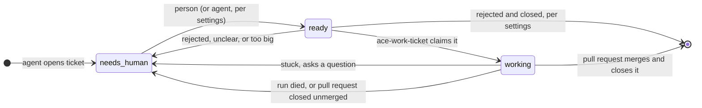

# Tickets and automation

[Back to README](../README.md)

Ace works in interactive chat with no ticket tracker or runner. When you are ready to run Ace on a backlog or from CI, configure tickets (`/ace-setup tickets`) and automated runs (`/ace-setup cycle`).

> [!WARNING]
> Use automated Ace runs only in private repositories for now. While `ace-babysit-pr` and `ace-work-ticket` ignore comments from outside contributors and `ace-babysit-pr` / `ace-review` never edit control files (such as `.github/workflows/` or `AGENTS.md`), Ace still reads code diffs and does not yet run untrusted diffs in a read-only sandbox.

## Ticket states

`ace-work-ticket` claims a ready ticket and sets it `working`, one run at a time. The ticket stays `working` until its pull request merges and closes it. When a run dies, or a person closes its pull request unmerged, the next run finds the ticket still `working` with no open pull request and, once the claim is 90 minutes old, sends it back to `needs-human` with a comment saying why.

On GitHub Issues, the states are the labels `ace:needs-human`, `ace:ready`, and `ace:working`, and a ticket with high Risk also gets `risk:high`. A ticket with no state label is outside the agent queue, such as one a person builds.

For another tracker (such as Linear or Jira), `ace/TICKET_TRACKER.md` describes how Ace reads, searches, opens, and updates tickets and maps each state.

## Model attribution

Everything Ace posts, such as a pull request, a review comment, or a ticket, starts with a line naming the model that wrote it, such as `Model: claude-sonnet-4-6` (or `Model: unknown` when the harness exposes no id). A runner can set it with `ACE_MODEL`.

Every ticket and pull request Ace opens also gets the permanent label `ace-created`, also when you asked for it in chat, so you can filter for Ace's work. It says who opened a ticket; the `ace:` state labels say whose turn it is.

## Running Ace with no person

You set up the runner (such as a GitHub Action, cron job, or cloud agent); Ace writes no CI config. Run `/ace-setup cycle` to record your automated jobs and triggers in `ace/CYCLE.md` so Ace coordinates hand-offs cleanly.

Common runner prompts:

- **PR review:** `Review pull request #12 and comment on it.` For review stages, such as one per label, name the checks: `Review pull request #12 with the spec check and comment on it.` Each set of checks keeps its own comment.
- **Ticket worker:** `Run ace-work-ticket.` (or `Run ace-work-ticket. Open the pull request as a draft.`). Run at most one ticket worker at a time.
- **Scheduled audit:** `Run ace-audit security.` (or another domain: `logic`, `performance`, `architecture`, `health`, or a custom check in `ace/checks/`).
- **PR explainer:** Add `ace-explain` to your review step to post a walkthrough and quiz on every pull request.

Leave every merge to a person. Ace stops at an open pull request.
