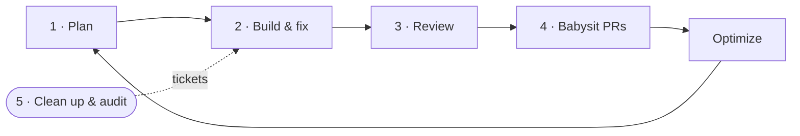

# Workflows and skills

[Back to README](../README.md)

In daily use, you do not need to memorize skill names. Say what you want in plain words, and `ace-mode` routes your message through the right skills in order.

## Five workflows

| Workflow | What to say | What Ace does |
|---|---|---|
| **Plan** | `"Plan dark mode for settings"` or `"Should we split X?"` | Ranks directions or challenges a proposal, settles material decisions with you, and writes a ticket or a temporary plan in `ace/temporary-plans/`. |
| **Build & fix** | `"Implement this plan"`, `"Fix the login redirect loop"`, or `"Refactor billing"` | Diagnoses unclear bugs, implements test-first, runs your checks in `ace/VERIFY.md`, and opens a PR when asked. |
| **Review** | `"Review my changes"` or `"Review PR #12"` | Checks the diff against its spec, your coding standards, code quality, and custom checks in `ace/checks/`. Fixes what `autonomy` allows and reports the rest. |
| **Babysit PRs** | `"Babysit PR #12"` or `"Watch PR #12 until green"` | Fixes failing CI, retries a flaky check once, resolves conflicts, and answers review comments until the PR is ready for a person to merge. |
| **Clean up & audit** | `"Clean up naming in src/billing"` or `"/ace-audit security"` | Makes one focused cleanup with behavior unchanged, or audits a domain across the repo and files tickets. |

**Also available:**

- **Explain:** Ask `"How does X work?"`, `"Why is Y built this way?"`, or post a PR explainer with a code walkthrough and quiz.
- **Improve the setup (Optimize):** Run a retro on a session, fix a named agent misbehaviour, check your `AGENTS.md`, or create and edit skills.

## Direct commands

Most tasks need no command name. Name a skill directly only in these cases:

| | Commands | When |
|---|---|---|
| **Setup** | `/ace-setup` | Guided 4-step core setup, `/ace-setup full` for everything, or one module: **Customize chat & reviews** (`standards`, `settings`) or **Tickets & automation** (`tickets`, `cycle`). |
| **On request or in a runner** | `/ace-help`, `/ace-work-ticket`, `/ace-audit`, `/ace-babysit-pr`, `/ace-garden` | When you want help with Ace, a targeted cleanup or audit, or an unattended CI or scheduled job. A runner reviews a PR with `Review pull request #12 and comment on it.` A person can say all of these in plain words too. |

> [!TIP]
> In Codex, type `$ace-setup`; in OpenCode (V2), type `@ace-setup` (or plain words like `Run ace-setup`).

## Steering the pace

You can steer how fast Ace moves without changing your settings:

- **Fast-track:** `"just build it"` or `"go with your recommendations"` skips optional pauses and remaining planning rounds, states assumed defaults in one line, and builds.
- **Quick fix:** `"quick fix ..."` skips the full hypothesis and shrink loop in `ace-diagnose` when the root cause is clear.
- **Chain to finish:** `"... and open a PR"`, `"... and review it"`, or `"fix and ship"` runs the named trailing steps in one turn without pausing to offer them.

Verification (`ace-verify`), coding standards, and the no-merge rule always stay on.

## Under the hood

Ace ships 17 skills as one set so they can load each other. `ace-mode` is the only skill exposed to the model by default; the others stay hidden until loaded or invoked by name.

Show all 17 skills (cycle and supporting)

### In the Ace cycle

| Stage | Skill | What it does |
|---|---|---|
| Plan | `ace-grill` | Settles what to build: ranks directions against your goal, or judges a proposed change, assumes sensible defaults for low-stakes details, interviews you only on material decisions, and writes the plan into a ticket or (without a tracker, for work bigger than `S`) into `ace/temporary-plans/` for a fresh implement session. |
| Plan | `ace-to-ticket` | Turns a plan into one ticket or several sub-tickets. |
| Build & fix | `ace-diagnose` | Finds and proves the root cause of an unclear or intermittent bug (obvious bugs go straight to a failing regression test and fix). |
| Build & fix | `ace-implement` | Builds the plan test-first. |
| Build & fix | `ace-verify` | Proves it works. |
| Build & fix | `ace-open-pr` | Opens the pull request. |
| Build & fix | `ace-work-ticket` | Runs this stage with no person: takes the next ready ticket, builds it, and opens a pull request. It skips a ticket an open pull request covers, and rejects one that is already done or wrong, with the evidence. |
| Review | `ace-review` | Checks the change against its ticket (**spec**), your coding standards (**standards**), its code (**code**), and your custom checks in `ace/checks/`. It fixes what `autonomy` allows and reports the rest. On a pull request it pushes its fixes and rates the Merge Danger; on a local diff it leaves them for you to commit. |
| Babysit PRs | `ace-babysit-pr` | Gets open pull requests ready: fixes failing checks, retries a flaky one once, resolves conflicts, and answers review comments from people and bots: it fixes what `autonomy` allows, proves a false claim wrong, and names scope creep as a follow-up. It never merges. Run it once, or in watch mode until each pull request is ready or needs a person. |
| Optimize | `ace-optimize-factory` | Runs a retro on a session, fixes one named misbehaviour, or checks the agents file. |
| Optimize | `ace-skill-best-practices` | Creates and edits skills. |

### Supporting skills

| Skill | What it does |
|---|---|
| `ace-mode` | The router. Picks the skills for each message, skips extra steps on straightforward tasks, and supports fast-tracking ("go with your recommendations" or "just do it"). It is the only skill the agent sees on its own; the others are hidden until it loads them, and you can still invoke any of them by name. |
| `ace-help` | Explains how Ace works, what is active in your project, and offers a repo-tailored walkthrough (`/ace-help tour`). Ask in words or run `/ace-help`. |
| `ace-setup` | Guides you step by step through setting up Ace: 4 core steps (with previews before writing) ending with 3 repo-tailored starter prompts, or run optional add-ons (**Customize chat & reviews**: `standards`, `settings`; **Tickets & automation**: `tickets`, `cycle`) or `full`, one decision at a time. |
| `ace-audit` | Audits the whole codebase per domain: security, logic, performance, architecture, health, and your custom checks. Each domain files up to three tickets by default. `/ace-audit security` runs one domain; `/ace-audit` asks which. Usually runs on a schedule. |
| `ace-garden` | Makes one small cleanup per run, below an audit's bar, on a topic and scope you pick, such as `/ace-garden naming src/billing`. Topics: **naming**, **comments** (tautological, stale, or excuse comments and unjustified suppressions), **tests** that cannot fail, **pass-through** wrappers, **deps** (bumps, keeping risky majors for a person), and your custom checks. It fixes one finding with behavior unchanged, or names up to three candidates when no fix is clean. Ask for a report to see findings without a change. |
| `ace-explain` | Explains how code works and why. For a pull request it can post an explainer with a code walkthrough and a quiz; add it to the CI step that runs your reviews to get one on every pull request. |

